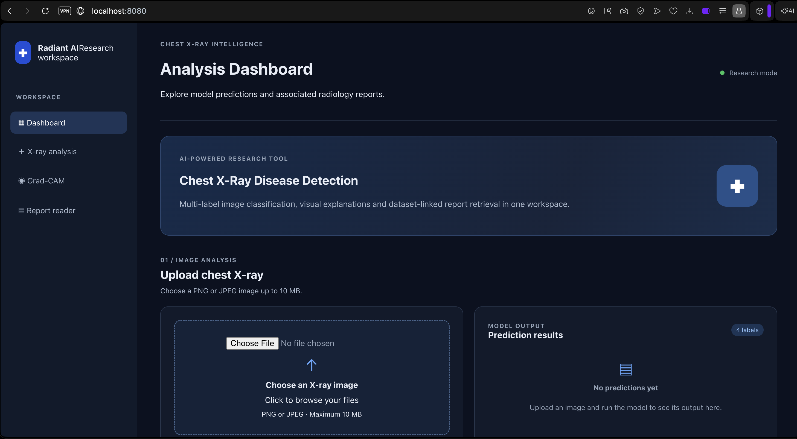
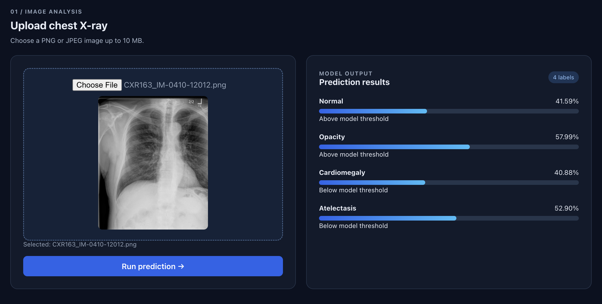
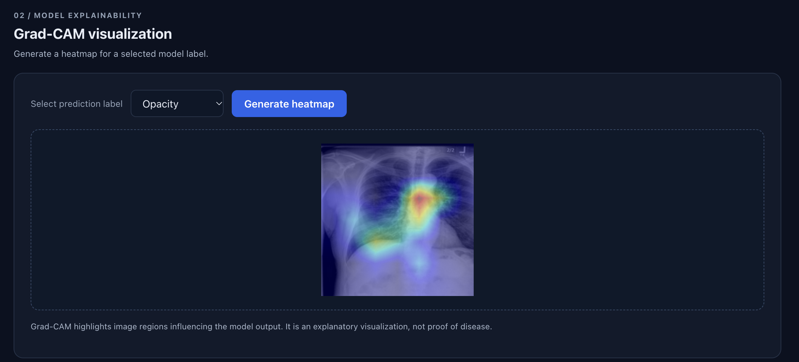
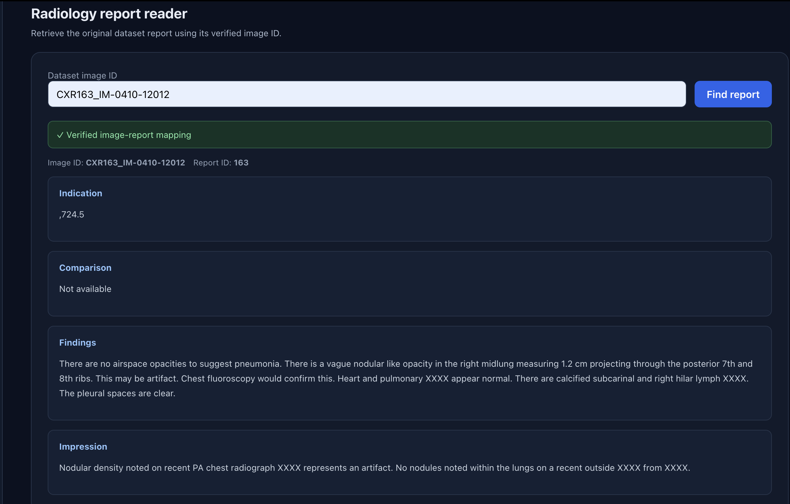
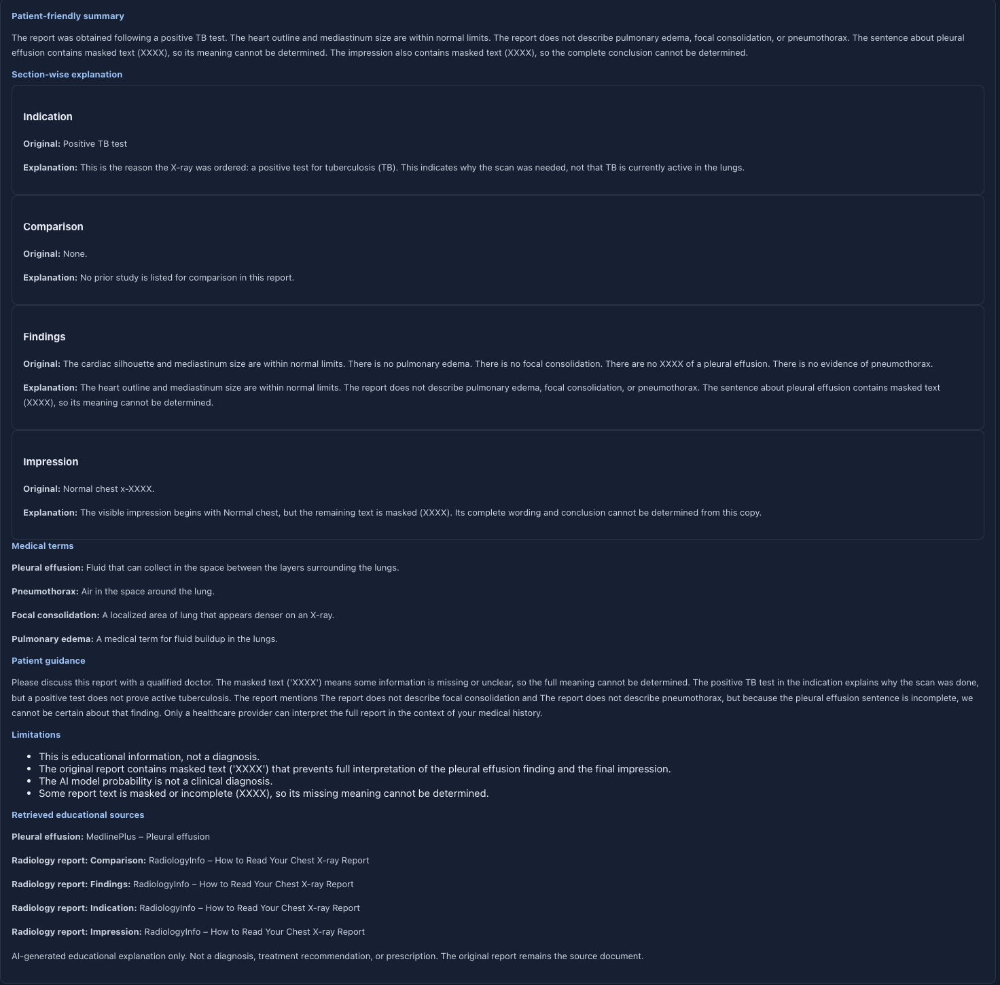

# Chest X-ray Disease Detection & Radiology Report Reader

An educational deep-learning and full-stack application that combines multi-label chest X-ray classification, Grad-CAM visualization, radiology report retrieval, and Retrieval-Augmented Generation (RAG) with a local Large Language Model (LLM).

**GitHub Repository:** https://github.com/Ishika08549/chest-xray-disease-detection-report-reader

> **Disclaimer:** This project is an educational research prototype, not a clinically validated medical device. Its predictions and AI-generated explanations must not be used for diagnosis, treatment, or medical decision-making.

## 1. Project Overview

The project provides an integrated workflow for exploring chest X-ray images and their associated radiology reports.

The application supports:

1. Uploading a chest X-ray image.
2. Predicting four candidate labels using a trained ResNet50 model.
3. Displaying prediction confidence scores.
4. Generating Grad-CAM visualizations to highlight image regions influencing model outputs.
5. Retrieving the original radiology report through a verified image-report mapping.
6. Explaining the retrieved report using a RAG pipeline and a locally hosted LLM.

The project combines computer vision, deep learning, explainability, information retrieval, natural language processing, and full-stack development.

## 2. System Workflow

```text
Chest X-ray Image
       |
       v
Image Preprocessing
       |
       v
ResNet50 Model
       |
       v
Multi-label Predictions
       |
       v
Confidence Scores + Grad-CAM

Image ID
   |
   v
Verified Report Retrieval
   |
   v
Original Radiology Report
   |
   v
Report Text Processing
   |
   v
Embedding-based Knowledge Retrieval
   |
   v
Top-k Relevant Knowledge
   |
   v
Qwen 3.5 LLM
   |
   v
Structured Educational Explanation
```

The image-classification and report-explanation pipelines are separate components connected through the application.

## 3. Dataset

**Dataset:** Indiana University Chest X-ray Collection
**Source:** [National Library of Medicine Open-i](https://openi.nlm.nih.gov/faq)

### Dataset preparation

- 7,471 chest X-ray images downloaded.
- 3,955 XML radiology reports parsed.
- 7,470 image-report mappings verified.
- Findings and Impression sections extracted.
- Image integrity and report mapping audits performed.
- Report-level train, validation, and test splitting used to reduce data leakage.

### Selected candidate labels

- Normal
- Opacity
- Cardiomegaly
- Atelectasis

The labels are derived from radiology report metadata and are weak labels, not independently verified radiologist annotations.

### Dataset split

| Split | Images |
|---|---:|
| Training | 3,022 |
| Validation | 635 |
| Test | 647 |
| **Total** | **4,304** |

Images associated with the same report were kept within the same split to reduce report-level leakage.

Raw images, XML reports, archives, processed datasets, and model checkpoints are excluded from the Git repository.

## 4. Deep Learning Model Development

The chest X-ray classification task is formulated as a **multi-label classification problem**, because multiple candidate labels may be associated with one image.

Three model experiments were conducted:

| Model | Description |
|---|---|
| ResNet18 V1 | Initial pretrained baseline |
| ResNet18 V2 | Improved experiment with augmentation, dropout, class-weighted binary cross-entropy, AdamW, and early stopping |
| ResNet50 | Pretrained ResNet50 transfer-learning experiment |

ResNet50 achieved the highest validation macro F1 among the three experiments and was selected as the application model.

### Validation results

| Model | Validation Macro F1 |
|---|---:|
| ResNet18 V1 | 0.5925 |
| ResNet18 V2 | 0.5959 |
| ResNet50 | 0.6046 |

### Held-out test results

| Metric | ResNet18 V2 | ResNet50 |
|---|---:|---:|
| Precision | 0.4892 | 0.5159 |
| Recall | 0.8035 | 0.7347 |
| Macro F1 | 0.5910 | 0.5877 |
| ROC-AUC | 0.8423 | 0.8361 |
| PR-AUC | 0.5825 | 0.5820 |

### Per-label test F1

| Label | ResNet18 V2 | ResNet50 |
|---|---:|---:|
| Normal | 0.8648 | 0.8628 |
| Opacity | 0.4346 | 0.4297 |
| Cardiomegaly | 0.5714 | 0.6021 |
| Atelectasis | 0.4931 | 0.4563 |

The test results show that overall performance is close. ResNet18 V2 has slightly higher test macro F1 and recall, while ResNet50 has higher mean precision and better Cardiomegaly F1.

The ResNet50 model was retained based on validation performance. Test results were reported transparently and were not used to retune classification thresholds.

Detailed results and limitations are available in [Model Evaluation](docs/model_evaluation.md).

## 5. Grad-CAM Explainability

Grad-CAM (Gradient-weighted Class Activation Mapping) is implemented to visualize image regions influencing a selected model output.

The implementation uses the final convolutional block of ResNet50.

Features include:

- Label-specific heatmap generation.
- Heatmap overlay on the original X-ray.
- Visual inspection of model attention patterns.

Grad-CAM is an approximate model explanation. It does not establish disease location, prove the presence of a condition, or provide a medical diagnosis.

## 6. Radiology Report Reader

The application retrieves the original radiology report using an image ID.

Report retrieval includes:

- Verified image-report mapping.
- Extraction of Indication, Comparison, Findings, and Impression sections.
- Display of original report text.
- Handling of missing or unavailable report records.

The report reader displays original dataset content. It does not independently create a clinical report.

## 7. Retrieval-Augmented Generation (RAG) and LLM

A RAG-based report explanation pipeline was added to help users understand medical terminology and the wording of retrieved radiology reports.

### 7.1 Knowledge Base

The medical knowledge corpus is maintained in:

`backend/app/data/medical_knowledge.json`

It contains explanatory content for topics such as:

- Cardiomegaly
- Pulmonary opacity
- Atelectasis
- Pleural effusion
- Indication
- Comparison
- Findings
- Impression

### 7.2 Embedding Model

The embedding model used is:

`text-embedding-nomic-embed-text-v1.5`

The model converts knowledge chunks and report-related queries into numerical vector representations.

### 7.3 Retrieval Mechanism

The retrieval pipeline:

1. Loads the medical knowledge corpus.
2. Generates embeddings for the knowledge chunks.
3. Generates an embedding for the input query.
4. Calculates cosine similarity between the query vector and knowledge vectors.
5. Ranks the knowledge chunks by similarity.
6. Retrieves relevant context for the explanation process.

The general knowledge retrieval function supports top-k retrieval, with a default `top_k` value of 4.

The current implementation uses an in-memory vector representation and cosine similarity. It does not use a persistent vector database.

### 7.4 Large Language Model

The locally hosted LLM is:

`qwen3.5-4b-mlx`

It is accessed through the LM Studio OpenAI-compatible local API.

The retrieved knowledge and original report content are supplied to the LLM to generate a structured, patient-friendly educational explanation.

### 7.5 Explanation Safety and Validation

The RAG service includes structured output validation and safeguards intended to:

- Explain only information supported by the visible report.
- Preserve masked text such as `XXXX`.
- Avoid inventing missing report content.
- Avoid unsupported diagnostic conclusions.
- Avoid treatment recommendations and prescriptions.
- Keep the original report as the source document.

The application returns a disclaimer explaining that the output is educational and not a diagnosis, treatment recommendation, or prescription.

### RAG implementation files

| File | Responsibility |
|---|---|
| `backend/app/services/rag_service.py` | Embedding, retrieval, LLM communication, output validation |
| `backend/app/data/medical_knowledge.json` | Medical knowledge corpus |
| `backend/app/main.py` | Report explanation API endpoint |

## 8. Full-Stack Application

The project includes a React frontend and FastAPI backend.

### Backend

- FastAPI application.
- X-ray image upload and prediction.
- Grad-CAM generation.
- Verified report retrieval.
- RAG-based report explanation.
- Image validation and error handling.
- CORS configuration.

### Frontend

- React dashboard built with Vite.
- X-ray upload interface.
- Prediction and confidence score display.
- Grad-CAM visualization.
- Radiology report reader.
- AI-generated report explanation display.
- Backend API connection status and medical disclaimer.

## 9. Backend API Endpoints

| Method | Endpoint | Purpose |
|---|---|---|
| GET | `/` | API home |
| GET | `/health` | Backend health check |
| POST | `/predict` | Multi-label X-ray prediction |
| POST | `/gradcam` | Grad-CAM visualization |
| GET | `/report/{image_id}` | Retrieve original report |
| POST | `/report/{image_id}/explain` | Generate RAG + LLM explanation |

Interactive API documentation is available at:

`http://127.0.0.1:8000/docs`

## 10. Technology Stack

| Category | Technologies |
|---|---|
| Programming Language | Python |
| Deep Learning | PyTorch, Torchvision |
| Models | ResNet18, ResNet50 |
| Data Processing | Pandas, NumPy, Pillow |
| Evaluation | Scikit-learn, Matplotlib |
| Explainability | Grad-CAM |
| Report Parsing | Python XML parser |
| Backend | FastAPI, Uvicorn |
| Frontend | React, Vite, JavaScript, CSS |
| Embeddings | Nomic Embed Text |
| LLM | Qwen 3.5 4B MLX |
| Local LLM Runtime | LM Studio |
| API Communication | HTTP, REST |
| Containerization | Docker, Docker Compose |
| Version Control | Git, GitHub |

## 11. Repository Structure

```text
chest_xray_report_reader_starter/
├── backend/
│   ├── app/
│   │   ├── api/
│   │   ├── data/
│   │   │   └── medical_knowledge.json
│   │   ├── schemas/
│   │   ├── services/
│   │   │   ├── model_service.py
│   │   │   ├── report_service.py
│   │   │   └── rag_service.py
│   │   └── main.py
│   └── tests/
├── frontend/
│   ├── public/
│   ├── src/
│   ├── package.json
│   └── README.md
├── scripts/
├── docs/
│   ├── architecture.md
│   ├── dataset_and_limitations.md
│   ├── model_evaluation.md
│   └── screenshots/
├── data/                 # Local dataset; excluded from Git
├── outputs/              # Local models; excluded from Git
├── Dockerfile
├── compose.yaml
├── requirements.txt
├── requirements-dev.txt
└── README.md
```

## 12. Local Development Setup

### Prerequisites

- Python 3.13
- Node.js 22 and npm
- Git
- LM Studio for local RAG and LLM functionality

### Required local assets

The following files must be available locally:

- `outputs/models/best_resnet50.pth`
- `data/processed/image_report_dataset.csv`

These assets are excluded from Git and must be generated or obtained separately.

### Backend installation

From the repository root:

```bash
python3 -m venv .venv
source .venv/bin/activate
python -m pip install --upgrade pip
python -m pip install -r requirements-dev.txt
```

### Frontend installation

Open another terminal:

```bash
cd frontend
npm ci
```

### Configure LM Studio

1. Install and open LM Studio.
2. Load `qwen3.5-4b-mlx`.
3. Load `text-embedding-nomic-embed-text-v1.5`.
4. Start the local API server.
5. Confirm that the configured models are available through the local API.

The default local API base URL is:

`http://127.0.0.1:1234/v1`

The RAG service reads the model names and API base URL from environment variables, with defaults defined in `rag_service.py`.

For Docker execution, the backend must be configured to reach the host machine's LM Studio server.

### Run backend

From the repository root:

```bash
source .venv/bin/activate
python -m uvicorn backend.app.main:app --reload
```

### Run frontend

From the frontend directory:

```bash
npm run dev
```

Open the local URL displayed by Vite, usually:

`http://localhost:5173`

## 13. Docker Execution

The project supports local containerized execution through `compose.yaml`.

### Prerequisites

- Docker Desktop
- Docker Compose
- Required local model and dataset assets

### Build and start

From the repository root:

```bash
docker compose -f compose.yaml up -d --build
```

### Access the application

| Component | URL |
|---|---|
| Frontend | http://localhost:8080 |
| Backend API | http://localhost:8000 |
| Health Check | http://localhost:8000/health |
| API Documentation | http://localhost:8000/docs |

### Check containers

```bash
docker compose -f compose.yaml ps
```

### View logs

```bash
docker compose -f compose.yaml logs --tail 100
```

### Stop containers

```bash
docker compose -f compose.yaml down
```

The frontend is served through Nginx and communicates with the FastAPI backend.

**Important:** The report explanation feature also requires the LM Studio server and both configured models to be running and reachable by the backend.

Docker execution is intended for local educational demonstration, not production medical deployment.

## 14. Testing and Quality Checks

The project has undergone backend, frontend, and local integration testing.

### Backend tests

Latest verified result:

**13 passed**

Run:

```bash
python -m pytest backend/tests/test_api.py -v
```

### Frontend lint

Latest verified result: 0 warnings and 0 errors.

```bash
cd frontend
npm run lint
```

### Frontend production build

Latest verified result: successful.

```bash
npm run build
```

### Manual application testing

The following workflows were manually tested:

- Dashboard loading.
- X-ray image upload and prediction.
- Grad-CAM visualization.
- Radiology report retrieval.
- RAG-based report explanation.

The local RAG explanation API was also tested successfully with a sample report.

## 15. Application Screenshots

### Dashboard



### X-ray Prediction



### Grad-CAM Visualization



### Radiology Report Reader



### RAG Report Explanation



Training and evaluation plots are documented in the model evaluation section.

## 16. Limitations and Responsible Use

- The dataset labels are weak labels derived from report metadata.
- The dataset is limited to a selected subset of the Indiana University Chest X-ray Collection.
- Classification performance is moderate and varies across labels.
- The model is not clinically validated.
- Grad-CAM is an approximate visualization, not proof of disease localization.
- The RAG knowledge corpus is limited and does not represent comprehensive medical knowledge.
- Embedding retrieval currently uses in-memory vectors rather than a persistent vector database.
- LLM explanations may contain errors or omissions despite validation safeguards.
- Masked or incomplete source-report text cannot be reliably reconstructed.
- The application is an educational prototype and must not be used for medical decisions.

## 17. Future Improvements

- Expand and improve the quality of the training dataset.
- Evaluate performance on independent external datasets.
- Improve class-specific model performance.
- Add more robust retrieval evaluation.
- Expand and validate the medical knowledge corpus.
- Add persistent vector database support if required.
- Improve automated testing of RAG output quality.
- Improve deployment security and monitoring.

## 18. Project Documentation

Additional technical documentation:

- [Architecture](docs/architecture.md)
- [Dataset and Limitations](docs/dataset_and_limitations.md)
- [Model Evaluation](docs/model_evaluation.md)

## 19. Author and Repository

**GitHub:** [Ishika Pandey](https://github.com/Ishika08549)

**Project Repository:** [Chest X-ray Disease Detection & Radiology Report Reader](https://github.com/Ishika08549/chest-xray-disease-detection-report-reader)

---

**Project Type:** Deep Learning + Computer Vision + RAG + LLM + Full-Stack Web Application

**Purpose:** Educational research and portfolio demonstration only.
