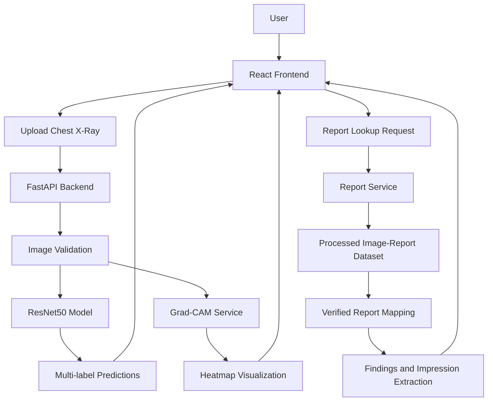

# System Architecture

## Chest X-Ray Disease Detection & Radiology Report Reader

The application follows a frontend-backend architecture with a deep learning inference service and a radiology report extraction service.

## Main Components

1. **React Frontend:** Provides the dashboard, X-ray upload, prediction results, Grad-CAM visualization, and report reader.
2. **FastAPI Backend:** Handles API requests, image validation, model inference, Grad-CAM generation, and report lookup.
3. **ResNet50 Model:** Performs multi-label classification for Normal, Opacity, Cardiomegaly, and Atelectasis.
4. **Grad-CAM:** Generates visual heatmaps to help inspect image regions influencing model predictions.
5. **Report Service:** Uses verified image-report mappings to retrieve radiology report information and extract Findings and Impression.
6. **Docker:** Runs the frontend and backend as separate services for local demonstration.

## Prediction Workflow

1. User uploads a chest X-ray through the React interface.
2. FastAPI validates the uploaded image.
3. The ResNet50 model generates four label scores.
4. Grad-CAM generates a heatmap for the selected label.
5. Results are returned to the frontend.

## Report Reading Workflow

1. User enters an image ID.
2. FastAPI searches the processed image-report dataset.
3. The service verifies the image-report mapping.
4. The report parser extracts available report sections.
5. The frontend displays the retrieved report.

## Disclaimer

This is an educational research prototype and is not intended for clinical diagnosis or medical decision-making.
